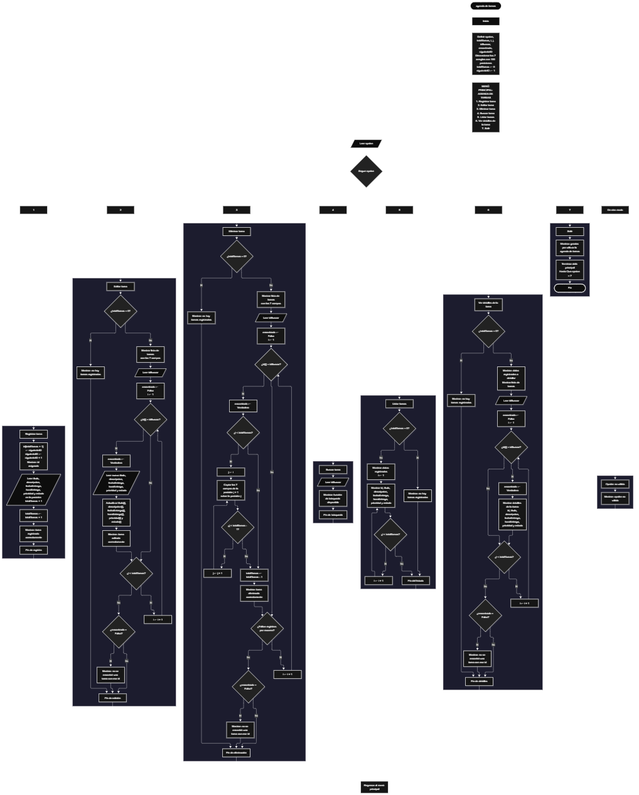

Este proyecto, llamado <b>agenda de tareas</b>, fue desarrollado en <b>pseint</b> como un ejercicio práctico para fortalecer la lógica de programación mediante la creación de un sistema de gestión de tareas desde la consola. El programa cuenta con un menú principal de siete opciones que permite <b>registrar, editar, eliminar, buscar, listar y consultar los detalles</b> de las tareas almacenadas. Cada tarea guarda datos como el id, el título, la descripción, la fecha de entrega, la hora de entrega, la prioridad y el estado, utilizando arreglos con una capacidad de <b>100 posiciones durante la ejecución</b>. Durante su desarrollo se aplicaron conceptos fundamentales de programación, como variables, arreglos, estructuras condicionales, ciclos repetitivos y estructuras de selección, además de procesos para modificar, eliminar y organizar registros. Este proyecto permite poner en práctica los conocimientos adquiridos en PSeInt y sirve como base para desarrollar sistemas de gestión más avanzados utilizando otros lenguajes y tecnologías.

<h2 align="center">⚙️ Funcionamiento del menú principal</h2>

### ➕ Registrar tarea

La opción <b>1) registrar tarea</b> permite agregar una nueva tarea a la agenda. El <b>id se asigna automáticamente</b> a partir de la variable <b>siguienteid</b>, que comienza en 1 y aumenta en uno con cada tarea registrada. El programa guarda el id en la posición <b>totaltareas + 1</b>, lo muestra al usuario con el mensaje <b>"id asignado"</b> y solicita el <b>título, la descripción, la fecha de entrega, la hora de entrega, la prioridad y el estado</b>, guardando cada dato en la misma posición de su respectivo arreglo. Finalmente, la variable <b>totaltareas</b> aumenta en uno y se muestra el mensaje <b>"tarea registrada correctamente."</b>. Como <b>siguienteid</b> solo aumenta y nunca disminuye, un id nuevo no coincide con el de una tarea existente aunque se hayan eliminado tareas antes.

### ✏️ Editar tarea

La opción <b>2) editar tarea</b> permite modificar la información de una tarea registrada. Primero, el programa comprueba si <b>totaltareas</b> es igual a cero; si no hay registros, muestra el mensaje <b>"no hay tareas registradas."</b>. En caso contrario, presenta la lista de tareas con todos sus datos separados por barras y solicita el <b>id</b> de la tarea que se desea editar. Mediante un ciclo <b>para</b> recorre los registros comparando <b>id[i] = idbuscar</b>. Cuando encuentra la coincidencia, cambia la variable lógica <b>encontrado</b> a <b>verdadero</b>, solicita el nuevo título, la nueva descripción, la nueva fecha de entrega, la nueva hora de entrega, la nueva prioridad y el nuevo estado, y actualiza directamente los arreglos. El id de la tarea se conserva sin cambios. Finalmente, muestra el mensaje <b>"tarea editada correctamente."</b>. Si no existe una tarea con ese id, presenta el mensaje <b>"no se encontró una tarea con ese id."</b>.

### 🗑️ Eliminar tarea

La opción <b>3) eliminar tarea</b> permite quitar una tarea registrada mediante su id. Antes de comenzar, el programa comprueba que existan tareas almacenadas; si la agenda está vacía, muestra el mensaje <b>"no hay tareas registradas."</b>. Si hay registros, presenta la lista y solicita el id de la tarea que se desea eliminar. Mediante un ciclo <b>para</b> recorre los registros y, cuando encuentra la coincidencia, comprueba que la posición sea menor que <b>totaltareas</b> y utiliza un ciclo <b>para</b> controlado por la variable <b>j</b>, que comienza en la posición encontrada y llega hasta <b>totaltareas - 1</b>, copiando los datos de la posición siguiente sobre la actual en los siete arreglos. Después, disminuye <b>totaltareas</b> en uno y muestra el mensaje <b>"tarea eliminada correctamente."</b>. Si el id no corresponde a ninguna tarea, muestra el mensaje <b>"no se encontró una tarea con ese id."</b>.

### 🔎 Buscar tarea

La opción <b>4) buscar tarea</b> está pensada para localizar una tarea mediante su id. En la versión actual del código, el programa solicita el <b>id</b> de la tarea y muestra el mensaje <b>"función de búsqueda disponible."</b>, por lo que esta opción funciona como estructura base y queda <b>pendiente de implementar</b> el recorrido del arreglo que compare <b>id[i] = idbuscar</b> y muestre los datos de la tarea encontrada.

### 📋 Listar tareas

La opción <b>5) listar tareas</b> permite visualizar todas las tareas registradas en la agenda. Antes de mostrar la información, el programa comprueba si <b>totaltareas</b> es igual a cero. Si no existen registros, presenta el mensaje <b>"no hay tareas registradas."</b>. Si hay tareas disponibles, muestra el mensaje <b>"datos registrados"</b> y utiliza un ciclo <b>para</b> que recorre los arreglos desde la primera posición hasta el total de tareas registradas, mostrando en una sola línea, separados por barras, el <b>id, el título, la descripción, la fecha de entrega, la hora de entrega, la prioridad y el estado</b> de cada tarea.

### 📄 Ver detalles de la tarea

La opción <b>6) ver detalles de la tarea</b> permite consultar toda la información de una tarea específica. Primero, el programa comprueba si existen tareas registradas; si la agenda está vacía, muestra el mensaje <b>"no hay tareas registradas."</b>. En caso contrario, presenta la lista de tareas para facilitar su identificación y solicita el <b>id</b> de la tarea que se desea consultar. Mediante un ciclo <b>para</b> recorre los registros y, cuando encuentra la coincidencia, cambia <b>encontrado</b> a <b>verdadero</b> y muestra los datos de la tarea en líneas separadas: <b>id, título, descripción, fecha de entrega, hora de entrega, prioridad y estado</b>. Si no existe una tarea con ese id, presenta el mensaje <b>"no se encontró una tarea con ese id."</b>.

### 🚪 Salir del menú principal

La opción <b>7) salir</b> finaliza la ejecución del programa y muestra el mensaje <b>"gracias por utilizar la agenda de tareas."</b>. El menú principal se encuentra dentro de una estructura repetitiva <b>repetir ... hasta que</b> con la condición <b>opcion = 7</b>, que coincide con la opción de salida del menú, por lo que el ciclo termina correctamente al seleccionarla.

<h2 align="center">🧠 Temas aplicados en el proyecto</h2>

### 📦 Variables

En este proyecto se utilizan variables para guardar la opción seleccionada en el menú, controlar la cantidad de tareas registradas, generar los ids automáticos, recorrer los arreglos, almacenar el id que se desea buscar y comprobar si se encontró una coincidencia. Todas están definidas explícitamente, lo que hace el código más claro y ordenado.

🔢 **Opcion:** Variable de tipo entero que almacena la opción seleccionada por el usuario en el menú principal.

📊 **TotalTareas:** Variable de tipo entero que almacena la cantidad actual de tareas registradas.

🆔 **SiguienteID:** Variable de tipo entero que guarda el próximo id disponible. Comienza en 1 y solo aumenta, lo que evita que se repitan ids.

🔄 **I:** Variable de tipo entero que funciona como contador en los ciclos <b>para</b> que recorren los arreglos.

🔁 **J:** Variable de tipo entero que controla el recorrido utilizado para desplazar los datos durante la eliminación de una tarea.

🔎 **IdBuscar:** Variable de tipo entero que almacena el id introducido por el usuario para editar, eliminar, buscar o consultar una tarea.

✅ **Encontrado:** Variable de tipo lógico que indica si se encontró una tarea con el id solicitado.

### 🗃️ Arreglos

En este proyecto se utilizan siete arreglos relacionados con los datos de cada tarea. Cada arreglo tiene una capacidad de <b>100 posiciones</b> y utiliza el mismo índice para representar la información correspondiente a una misma tarea. Por ejemplo, los datos de una tarea almacenada en la posición <b>1</b> se encuentran distribuidos entre <b>id[1], titulo[1], descripcion[1], fechaEntrega[1], horaEntrega[1], prioridad[1] y estado[1]</b>. Esta organización permite recorrer, modificar, mostrar y eliminar las tareas de manera ordenada.

🆔 **Id[100]:** Almacena el identificador de cada tarea, asignado automáticamente.

📝 **Titulo[100]:** Almacena el título de la tarea.

📄 **Descripcion[100]:** Almacena la descripción de la tarea.

📅 **FechaEntrega[100]:** Almacena la fecha límite de entrega.

⏰ **HoraEntrega[100]:** Almacena la hora límite de entrega.

🚩 **Prioridad[100]:** Almacena la prioridad de la tarea.

📌 **Estado[100]:** Almacena el estado actual de la tarea.

### 🔀 Estructuras condicionales

En este proyecto se utilizan las estructuras <b>si</b> y <b>sino</b> para verificar si existen tareas registradas antes de editar, eliminar, listar o ver detalles, para comprobar que existan registros posteriores que desplazar al eliminar y para determinar si el id introducido corresponde a una tarea existente. Estas condiciones permiten que el programa responda de manera diferente según el estado de la agenda y el resultado de cada operación.

### 🔄 Estructuras repetitivas

En este proyecto se utilizan los ciclos <b>para</b> y <b>repetir ... hasta que</b>. Los ciclos <b>para</b> permiten recorrer los arreglos para mostrar las tareas y buscar un id; durante la eliminación, también se utilizan para desplazar los datos de las tareas posteriores una posición hacia atrás. Por otro lado, el ciclo <b>repetir ... hasta que</b> mantiene activo el menú principal para que el usuario pueda ejecutar diferentes operaciones antes de salir del programa.

### 🎯 Estructura según

El programa evalúa el valor almacenado en la variable <b>opcion</b> y ejecuta el bloque de instrucciones correspondiente. Cada caso representa una operación del sistema: <b>registrar, editar, eliminar, buscar, listar, ver detalles o salir</b>. También se utiliza el bloque <b>de otro modo</b> para mostrar el mensaje <b>"opción no válida."</b> cuando el valor introducido no coincide con ninguna de las opciones definidas.

### 🔢 Dimensionamiento de arreglos

El programa utiliza la instrucción <b>dimension</b> para establecer la capacidad de los arreglos que almacenan la información de las tareas. Se definieron <b>100 posiciones</b> para cada arreglo, lo que permite administrar hasta 100 tareas durante la ejecución. La cantidad de posiciones ocupadas se controla mediante la variable <b>totaltareas</b>, por lo que las operaciones recorren únicamente los registros comprendidos entre la primera posición y el total actual de tareas.

### 🔄 Reorganización de registros

Cuando se selecciona una tarea para eliminarla, el programa utiliza un ciclo <b>para</b> que comienza en la posición encontrada y llega hasta <b>totaltareas - 1</b>. En cada repetición, los datos de la posición siguiente se copian sobre la posición actual en los siete arreglos. Después, la variable <b>totaltareas</b> disminuye en uno. De esta manera, las tareas posteriores ocupan las posiciones disponibles sin dejar espacios vacíos entre los registros activos.

<h2 align="center">¿Cómo se implementaron las operaciones crud en el proyecto?</h2>

Las operaciones <b>crud</b> se implementaron mediante las opciones del menú principal, permitiendo administrar las tareas registradas. La operación <b>crear</b> corresponde a <b>registrar tarea</b>, donde se introducen los datos de una nueva tarea y el id se asigna automáticamente; <b>leer</b> se realiza mediante las opciones <b>listar tareas y ver detalles de la tarea</b> y, una vez implementada, <b>buscar tarea</b>; <b>actualizar</b> corresponde a <b>editar tarea</b>, donde se modifican los datos de una tarea registrada; y <b>eliminar</b> se realiza mediante la opción <b>eliminar tarea</b>. Estas operaciones utilizan variables, arreglos, condicionales y ciclos para gestionar la información almacenada temporalmente durante la ejecución del programa.

<h2 align="center">Diagrama de flujo del proyecto</h2>

<h2 align="center">🛡️ Validaciones del programa</h2>

### 📭 No existen tareas registradas

Esta validación se utiliza en las opciones de <b>editar, eliminar, listar y ver detalles</b>. El programa comprueba si la variable <b>totaltareas</b> es igual a <b>0</b> y, si no existen tareas registradas, muestra el mensaje <b>"no hay tareas registradas."</b>. Esta comprobación evita continuar con operaciones que necesitan información almacenada cuando la agenda está vacía.

### 🆔 Id único

Al registrar una tarea, el programa asigna el id con la variable <b>siguienteid</b>, que comienza en 1 y aumenta en uno con cada registro, sin disminuir nunca al eliminar. De esta forma, cada tarea tiene un id distinto y las operaciones de editar, eliminar y ver detalles siempre actúan sobre una sola tarea.

### ❌ Tarea no encontrada

Esta validación se utiliza en las opciones de editar, eliminar y ver detalles. El programa inicializa la variable lógica <b>encontrado</b> con el valor <b>falso</b> y recorre el arreglo <b>id</b> comparando cada valor con el id introducido por el usuario. Cuando encuentra una coincidencia, cambia la variable a <b>verdadero</b> y realiza la operación. Si al finalizar el recorrido la variable <b>encontrado</b> continúa siendo <b>falso</b>, muestra el mensaje <b>"no se encontró una tarea con ese id."</b>.

### ⚠️ Opción inválida

La estructura <b>segun</b> incluye el bloque <b>de otro modo</b>, que muestra el mensaje <b>"opción no válida."</b> cuando el usuario introduce un número que no corresponde a ninguna de las opciones definidas en el menú.

<h2 align="center">🚧 Mejoras pendientes</h2>

Como parte del proceso de desarrollo, se identificaron aspectos que se pueden mejorar en próximas versiones del proyecto:

- Implementar la búsqueda real en la opción <b>4) buscar tarea</b>, reutilizando la lógica de ver detalles.
- Validar que <b>totaltareas</b> no supere las 100 posiciones disponibles (agenda llena).
- Validar que el id ingresado sea mayor que cero en las opciones de editar, eliminar y ver detalles.
- Convertir la <b>prioridad</b> y el <b>estado</b> en opciones fijas (por ejemplo, alta, media y baja; pendiente, en proceso y completada), validando que el usuario elija una de ellas.
- Validar el formato de la fecha y la hora de entrega.
- Definir explícitamente el tipo de los arreglos (<b>id</b> como entero y el resto como cadena).
- Terminar el ciclo de recorrido al encontrar el id en las opciones de editar, eliminar y ver detalles.

<h2 align="center">🎯 Objetivo del proyecto</h2>

El objetivo principal de este proyecto es fortalecer la <b>lógica de programación</b> mediante el desarrollo de un sistema de gestión de tareas en <b>pseint</b>. A través de su construcción se busca aplicar los conocimientos adquiridos sobre variables, arreglos, estructuras condicionales, ciclos repetitivos y estructuras de selección, integrándolos para resolver un problema de manera organizada. Además, el proyecto permite comprender cómo registrar, consultar, modificar y eliminar información en una aplicación de consola, estableciendo una base para desarrollar sistemas de gestión más completos con otros lenguajes y tecnologías.

